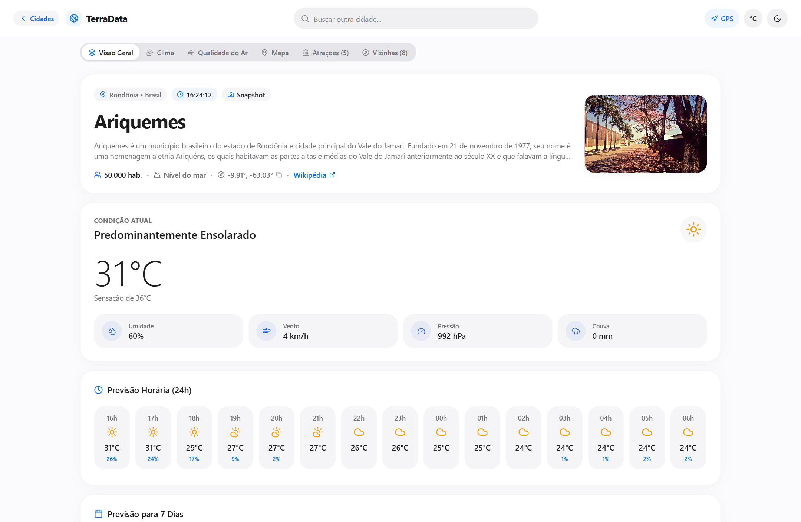
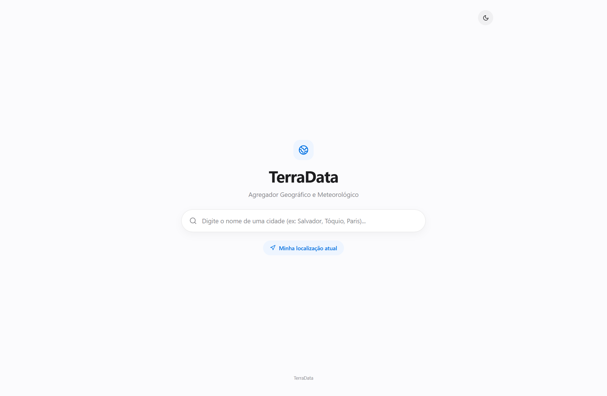
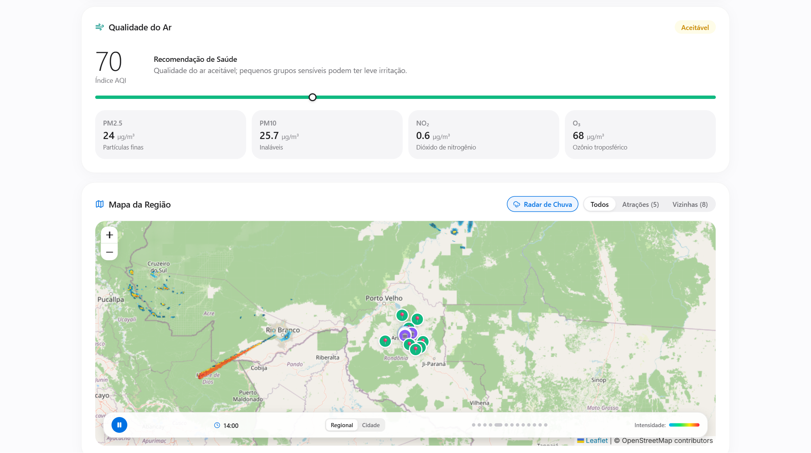
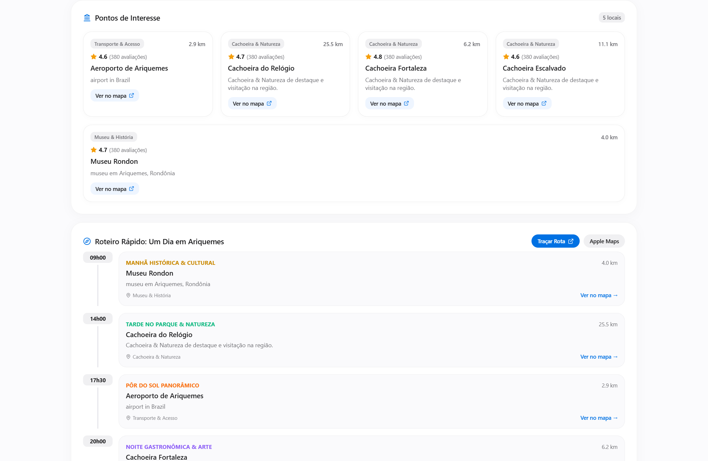
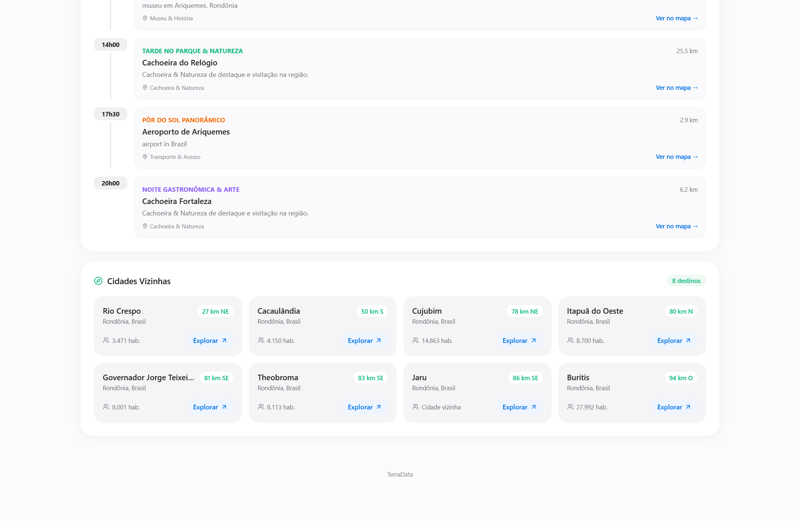
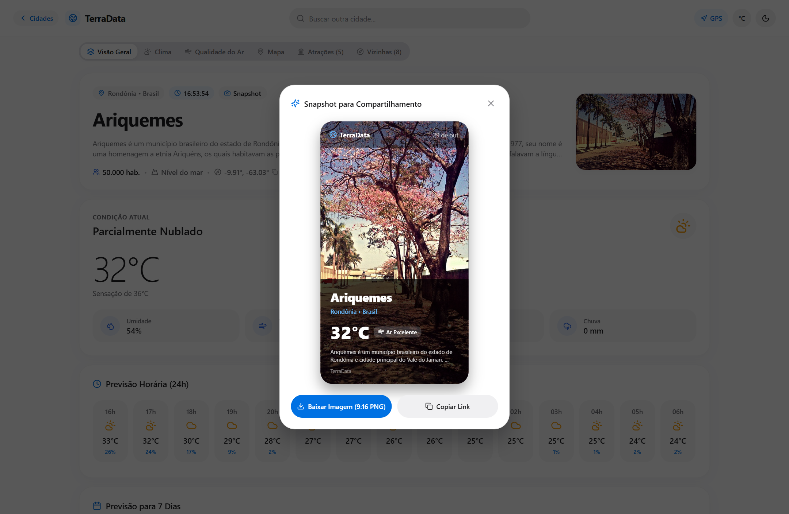
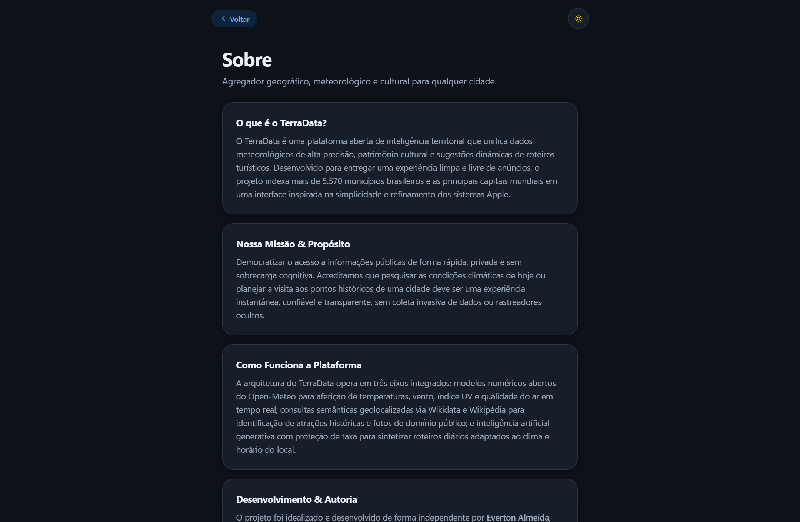
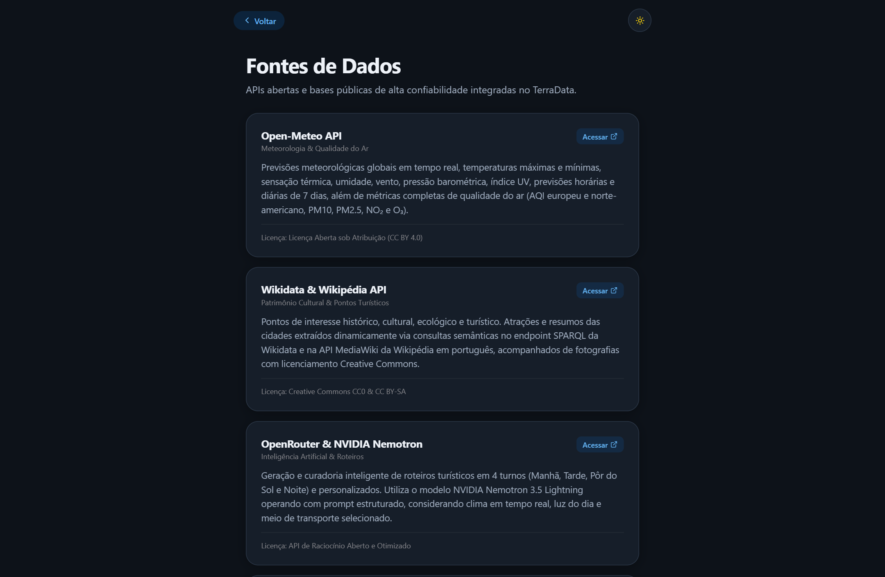

# TerraData

> Agregador inteligente de dados urbanos, climáticos e culturais em tempo real, construído com **React Native for Web**, **Next.js 15**, **TypeScript** e **Cloudflare Workers (Hono Edge BFF)**, projetado sob as diretrizes do **Apple Human Interface Guidelines (HIG)**.

[](https://nextjs.org/)
[](https://necolas.github.io/react-native-web/)
[](https://www.typescriptlang.org/)
[](https://workers.cloudflare.com/)
[](https://hono.dev/)
[](https://leafletjs.com/)
[](https://www.chartjs.org/)
[](https://everton.net.br)
[](LICENSE)

---

## 📑 Sumário

- [Visão Geral](#-visão-geral)
- [Funcionalidades](#-funcionalidades)
- [Arquitetura & Fluxo](#-arquitetura--fluxo)
- [Stack Tecnológica](#-stack-tecnológica)
- [Estrutura do Projeto](#-estrutura-do-projeto)
- [Como Executar o Projeto](#-como-executar-o-projeto)
- [Endpoints do Edge BFF](#-endpoints-do-edge-bff)
- [Galeria da Interface (Apple HIG)](#-galeria-da-interface-apple-hig)
- [APIs Públicas Integradas](#-apis-públicas-integradas)
- [Páginas Institucionais & Transparência](#-páginas-institucionais--transparência)
- [Qualidade e Validação](#-qualidade-e-validação)
- [Autor](#-autor)
- [Licença](#-licença)

---

## 🎯 Visão Geral

O **TerraData** é uma plataforma moderna e hiperveloz que consolida métricas geográficas, históricas e meteorológicas de mais de 5.570 municípios brasileiros e das principais capitais mundiais em uma experiência visual refinada, minimalista e livre de anúncios.

### Princípios de Engenharia e Design:
- **Padrão Estético Apple (Human Interface Guidelines)**: Tipografia pura do sistema (SF Pro), paleta pastel suave, superfícies translúcidas em vidro fosco (*frosted glass*), cantos arredondados contínuos (raio de 20px) e ausência de poluição visual.
- **Edge BFF na Cloudflare (Hono + Edge Cache)**: Camada de orquestração na borda que agrega previsões climáticas, qualidade do ar e Wikipédia em paralelo, servindo requisições em ~15ms via Cloudflare Cache com política `stale-while-revalidate`.
- **Busca Fuzzy Instantânea em 0ms**: Base local compacta contendo todos os **5.570 municípios brasileiros** e as principais metrópoles mundiais, permitindo autocomplete com resposta em 0ms sem chamadas de rede externas.
- **Skeletons Fluidos com Efeito Shimmer**: Transições orgânicas de carregamento com sweep gradiente contínuo e desbloqueio progressivo instantâneo (~200ms) sem travar a interface.
- **Privacidade & Transparência Absoluta**: Sem cookies de terceiros, sem rastreadores ocultos e com páginas dedicadas detalhando todas as fontes de dados e termos de uso.

<p align="center">
  
</p>

---

## 🚀 Funcionalidades

- **Busca Spotlight Centralizada**: Interface de boas-vindas minimalista inspirada no Spotlight da Apple, com histórico de cidades visitadas recentemente exibindo temperatura e ícones meteorológicos em tempo real.
- **Clima em Tempo Real & Previsão 7 Dias**: Temperatura atual, sensação térmica, umidade, velocidade do vento, pressão atmosférica e probabilidade de chuva alimentados pela Open-Meteo.
- **Gráfico Interativo de Variação Térmica (24h)**: Curva contínua ultra suave (Bézier tension 0.4) de temperatura e barras de probabilidade de precipitação via Chart.js.
- **Índice de Qualidade do Ar (AQI)**: Espectro contínuo pastel com marcador dinâmico estilo Apple Health e discriminação de poluentes (PM2.5, PM10, Ozônio, NO₂).
- **Radar de Precipitação ao Vivo**: Cobertura de radar meteorológico em tempo real sobre Leaflet com animação contínua e controle temporal via RainViewer API.
- **Smart Insights do Dia & Golden Hour**: Cálculo preditivo dos horários exatos de fotografia (*Golden Hour* matinal e vespertina), melhor janela do dia para atividades ao ar livre e monitor de radiação UV.
- **Roteiro Rápido ("Um Dia na Cidade") com IA**: Planejamento inteligente em 4 turnos (Manhã, Tarde, Pôr do Sol e Noite) alimentado por inteligência artificial (NVIDIA Nemotron via OpenRouter) e integração 1-click para Google Maps e Apple Maps.
- **Pontos de Interesse e Cultura**: Monumentos históricos, museus, parques e marcos culturais georreferenciados com fotos em alta definição do Wikidata e Wikipédia.
- **Municípios Vizinhos (Raio de 100km)**: Identificação automática de cidades adjacentes com cálculo de distância, orientação de bússola (N, S, L, O) e alternância instantânea de cidade.
- **Snapshot Card para Stories (9:16)**: Geração nativa em HTML5 Canvas de cartões verticais em alta resolução (1080x1920) para compartilhamento no Instagram Stories, WhatsApp Status e X.
- **Tema Claro / Escuro & Unidades (°C / °F)**: Alternância instantânea de tema com tokens semânticos e conversão dinâmica de temperatura com persistência em `localStorage`.
- **Páginas Institucionais Dedicadas**: Seções completas de **Sobre**, **Fontes de Dados** e **Contato** integradas com navegação tátil suave e estilo nativo.

---

## 🏛 Arquitetura & Fluxo

### 1. Consulta Agregada no Edge BFF (`GET /api/city`)

O TerraData adota o padrão **Backend-for-Frontend (BFF)** hospedado na borda da Cloudflare utilizando o micro-framework **Hono**. Múltiplas APIs de terceiros são consultadas em paralelo com canonicalização de coordenadas geográficas (`lat.toFixed(3), lon.toFixed(3)`).

```text
Navegador (Client)            Cloudflare Edge (Hono)           APIs Públicas de Origem
       │                                │                                   │
       │─── GET /api/city?lat=&lon= ───►│                                   │
       │                                │─── Cloudflare Edge Cache (Check)  │
       │                                │                                   │
       │◄── HIT: Cache (~15ms) ─────────│ (se em cache, retorna imediato)   │
       │                                │                                   │
       │                                │─── (MISS: Fan-out Paralelo) ─────►│
       │                                │     ├─ Open-Meteo Weather         │
       │                                │     ├─ Open-Meteo Air Quality     │
       │                                │     └─ Wikipedia Summary & Image  │
       │                                │◄── Respostas Agregadas ───────────│
       │                                │                                   │
       │◄── Resposta JSON Unificada ────│─── Cache.put() em Background ────►│
       │                                │     (waitUntil sem bloquear client)
```

### 2. Desbloqueio Progressivo no Frontend

Para eliminar a percepção de lentidão causada por consultas SPARQL profundas no Wikidata (que podem levar 3 a 5 segundos), o TerraData implementa **desbloqueio progressivo**:

```text
1. Início da Busca ──────► Renderiza DashboardSkeleton com Shimmer Sweep Contínuo
                                  │
2. Bundle /api/city (~200ms) ────► Desbloqueia Tela Principal (HeroBanner, Clima, Gráficos)
                                  │
3. /api/pois em Background ──────► Preenche Cards de Turismo e Roteiro de 4 Turnos
```

---

## 🛠 Stack Tecnológica

### Frontend
- **React 18 & Next.js 15** - Renderização de componentes e exportação estática (`output: 'export'`).
- **React Native for Web 0.19** - Arquitetura de componentes móvel/web unificada com layout Flexbox.
- **TypeScript 5.6** - Tipagem estática rigorosa de ponta a ponta.
- **Chart.js 4.4** - Gráficos meteorológicos com curvas Bézier calibradas e eixos sem ruído.
- **Leaflet 1.9** - Cartografia interativa com renderização de tiles do CartoDB / OpenStreetMap.
- **Lucide React** - Ícones vetoriais monocromáticos com espessuras de traço padronizadas.

### Backend na Borda (Cloudflare Workers BFF)
- **Cloudflare Workers** - Execução Serverless em V8 Isolates distribuídos globalmente.
- **Hono 4.13** - Framework ultra-leve para roteamento HTTP com suporte nativo a Web Standards.
- **Cloudflare Cache API** - Armazenamento de respostas de borda com cabeçalhos `Cache-Control` calibrados e expiração dinâmica.
- **Wrangler 4.156** - Toolchain oficial para build, emulação local e deploy na Cloudflare.

### Inteligência Artificial & Roteiros
- **OpenRouter & NVIDIA Nemotron 3.5 Lightning** - Geração sintética de roteiros estruturados adaptados ao clima atual, luz do dia e meio de transporte.

### Design System & Estilo
- **Apple Human Interface Guidelines (HIG)**
- Superfícies em **Frosted Glass** (`backdrop-filter: blur(20px)`)
- Fontes nativas do sistema (`-apple-system, BlinkMacSystemFont, "SF Pro Text", "Segoe UI"`)
- Variantes tabulares de números (`fontVariant: ['tabular-nums']`) para relógios e termômetros

---

## 📁 Estrutura do Projeto

```text
terradata/
├── components/                 # Componentes de interface (React Native Web)
│   ├── AirQualitySection.tsx   # Medidor de AQI com espectro pastel
│   ├── DashboardSkeleton.tsx   # Skeleton screen com efeito shimmer
│   ├── Header.tsx              # Barra de navegação e busca rápida
│   ├── HeroBanner.tsx          # Resumo histórico, relógio e metadados
│   ├── HourlyChart.tsx         # Gráfico de previsão 24h em Chart.js
│   ├── InteractiveMap.tsx      # Mapa Leaflet com radar RainViewer
│   ├── LandingSearch.tsx       # Tela inicial Spotlight com recentes ao vivo
│   ├── LazyImage.tsx           # Imagens com carregamento preguiçoso
│   ├── NearbyCitiesSection.tsx # Cidades vizinhas em raio de 100km
│   ├── OneDayItinerary.tsx     # Roteiro sugerido em 4 turnos com IA
│   ├── POIsSection.tsx         # Atrações turísticas e culturais
│   ├── SmartDayInsights.tsx    # Golden hour, janela ao ar livre e UV
│   ├── SnapshotModal.tsx       # Gerador Canvas de card 9:16 para Stories
│   ├── Toast.tsx               # Notificações táteis flutuantes
│   └── WeatherSection.tsx      # Cards de clima atual e previsão 7 dias
├── docs/
│   └── assets/                 # Capturas de tela e demonstrações visuais
├── pages/
│   ├── api/                    # Rotas de desenvolvimento local do Next.js
│   │   ├── city.ts             # Bundle de clima, AQI e resumo
│   │   ├── itinerary.ts        # Gerador de roteiro via IA Nemotron
│   │   ├── pois.ts             # Pontos turísticos via Wikidata
│   │   └── search.ts           # Busca e geocodificação
│   ├── _app.tsx                # Inicialização global da aplicação
│   ├── _document.tsx           # Estrutura HTML e fontes nativas
│   ├── contato.tsx             # Página institucional de contato e redes
│   ├── fontes.tsx              # Transparência sobre APIs e dados abertos
│   ├── index.tsx               # Orquestrador central e gerenciador de estado
│   └── sobre.tsx               # Visão geral, missão e autoria do projeto
├── public/
│   ├── _headers                # Cabeçalhos de segurança e cache da Cloudflare
│   └── leaflet.css             # Estilos locais da biblioteca Leaflet
├── scripts/
│   ├── build_cities_data.js    # Gerador da base de municípios brasileiros e mundiais
│   └── take_screenshots.js     # Script de automação para captura de telas com Puppeteer
├── services/
│   ├── api.ts                  # Cliente de comunicação com BFF e fallbacks
│   ├── cache.ts                # Cache inteligente em memória / localStorage
│   ├── cityDatabase.ts         # Base comprimida de 5.570+ cidades (0ms search)
│   ├── fuzzySearch.ts          # Algoritmo de busca por similaridade de texto
│   ├── images.ts               # Resolução de imagens de capa da Wikipédia
│   ├── textMatch.ts            # Normalização de acentos e termos fonéticos
│   └── utils.ts                # Formatadores numéricos, datas e fusos horários
├── styles/
│   └── globals.css             # Animações shimmer, radar pulse e reset CSS
├── types/                      # Definições de tipos TypeScript
├── worker/                     # Cloudflare Worker BFF (Hono + TypeScript)
│   ├── index.ts                # Ponto de entrada Hono e roteamento de rotas
│   ├── types.ts                # Tipos de dados e contratos de resposta
│   ├── services/               # Módulos de integração com APIs externas
│   │   ├── airQuality.ts       # Open-Meteo Air Quality
│   │   ├── citySearch.ts       # Geocoding com cache de 24h
│   │   ├── pois.ts             # Wikidata SPARQL com timeout seguro
│   │   ├── weather.ts          # Open-Meteo Forecast
│   │   └── wiki.ts             # Wikipedia REST API Summary
│   └── utils/
│       ├── cache.ts            # Integração com a Cloudflare Cache API
│       └── timeout.ts          # Circuit breaker para APIs externas
├── next.config.js              # Configuração de build estático (output: 'export')
├── package.json
├── tsconfig.json
└── wrangler.toml               # Configuração de deploy do Cloudflare Worker
```

---

## 🚀 Como Executar o Projeto

### Pré-requisitos
- **Node.js**: v18.0.0 ou superior
- **npm**: v9.0.0 ou superior

### 1. Clonar o Repositório e Instalar Dependências

```bash
git clone https://github.com/EvertuN/terradata.git
cd terradata
npm install
```

### 2. Executar o Frontend em Modo de Desenvolvimento (Next.js)

```bash
npm run dev
```

Acesse no seu navegador: **`http://localhost:3000`**

### 3. Compilar para Produção (Exportação Estática)

```bash
npm run build
npm start
```

Os artefatos estáticos otimizados serão gerados na pasta `./out`.

### 4. Executar o Edge BFF com Cloudflare Workers Localmente

Para testar o Worker e os endpoints `/api/*` emulando o ambiente real da Cloudflare:

```bash
npx wrangler dev
```

O ambiente do Cloudflare Worker responderá em `http://localhost:8787` (ou porta configurada pelo Wrangler).

### 5. Fazer Deploy na Cloudflare

Para publicar o projeto na rede Edge global da Cloudflare:

```bash
npx wrangler deploy
```

---

## 🔌 Endpoints do Edge BFF

A camada de borda do Cloudflare Workers expõe endpoints consolidados com tempos de resposta mínimos:

| Método | Rota | Parâmetros | Descrição | Cache no Edge |
|---|---|---|---|:---:|
| `GET` | `/api/city` | `lat`, `lon`, `name` | Pacote unificado com Clima, Qualidade do Ar e Resumo da Wikipédia | **30 min** (`s-maxage=1800`) |
| `GET` | `/api/pois` | `lat`, `lon` | Pontos turísticos e atrações culturais via Wikidata SPARQL | **7 dias** (`s-maxage=604800`) |
| `GET` | `/api/search` | `q` | Busca e geocodificação global de cidades | **24 horas** (`s-maxage=86400`) |
| `POST` | `/api/itinerary` | `city`, `weather`, `pois` | Síntese de roteiro turístico em 4 turnos via IA Nemotron | **24 horas** (`s-maxage=86400`) |
| `GET` | `/api/health` | - | Verificação de disponibilidade e versão do Edge BFF | `no-cache` |

---

## 🎨 Galeria da Interface (Apple HIG)

Abaixo estão capturas reais da aplicação em execução, utilizando os dados em tempo real do município de **Ariquemes, Rondônia (Brasil)** e as páginas estáticas do TerraData.

### 1. Tela Inicial - Busca Minimalista (Apple Spotlight)
<p align="center">
  
</p>

### 2. Visão Geral do Dashboard & Clima
<p align="center">
  
</p>

### 3. Smart Insights do Dia & Golden Hour
<p align="center">
  
</p>

### 4. Qualidade do Ar & Radar Meteorológico em Tempo Real
<p align="center">
  
</p>

### 5. Pontos Culturais e Roteiro de 4 Turnos
<p align="center">
  
</p>

### 6. Cidades Vizinhas (Raio de 100km)
<p align="center">
  
</p>

### 7. Card Snapshot para Stories (9:16 Social Canvas)
<p align="center">
  
</p>

### 8. Página Sobre a Plataforma
<p align="center">
  
</p>

### 9. Transparência de Fontes de Dados
<p align="center">
  
</p>

### 10. Canais de Contato & Redes
<p align="center">
  
</p>

---

## 🌐 APIs Públicas Integradas

O TerraData é alimentado exclusivamente por fontes de dados públicas, gratuitas e de alta confiabilidade:

| Serviço / API | Provedor | Endpoint Principal | Documentação | Licenciamento / Dados | Descrição |
|---|---|---|---|---|---|
| **Weather Forecast API** | Open-Meteo | `api.open-meteo.com/v1/forecast` | [open-meteo.com/docs](https://open-meteo.com/en/docs) | CC BY 4.0 | Previsão climática atual, horária (24h) e semanal (7 dias). |
| **Air Quality API** | Open-Meteo | `air-quality-api.open-meteo.com/v1/air-quality` | [air-quality-api](https://open-meteo.com/en/docs/air-quality-api) | CC BY 4.0 | Índices AQI e concentração de PM2.5, PM10, Ozônio e NO₂. |
| **Geocoding API** | Open-Meteo | `geocoding-api.open-meteo.com/v1/search` | [geocoding-api](https://open-meteo.com/en/docs/geocoding-api) | CC BY 4.0 | Busca mundial de localidades por nome, coordenadas e altitude. |
| **Wikipedia REST API** | Wikimedia Foundation | `pt.wikipedia.org/api/rest_v1/page/summary/` | [mediawiki.org/REST_API](https://www.mediawiki.org/wiki/API:REST_API) | CC BY-SA 3.0 | Resumo histórico do município, fotos de capa e metadados. |
| **Wikidata Query Service** | Wikimedia Foundation | `query.wikidata.org/sparql` | [query.wikidata.org](https://query.wikidata.org/) | CC0 1.0 (Domínio Público) | Consulta SPARQL de marcos históricos, museus, praças e parques. |
| **RainViewer Radar API** | RainViewer | `api.rainviewer.com/public/weather-maps.json` | [rainviewer.com/api](https://www.rainviewer.com/api.html) | Gratuito / Dados Abertos | Camadas de tiles de radar meteorológico de precipitação em tempo real. |
| **Reverse Geocoding** | BigDataCloud | `api.bigdatacloud.net/data/reverse-geocode-client` | [bigdatacloud.com](https://www.bigdatacloud.net/) | Gratuito para Client-side | Geocodificação reversa instantânea por GPS ("Usar minha localização"). |
| **NVIDIA Nemotron 3.5** | OpenRouter | `openrouter.ai/api/v1/chat/completions` | [openrouter.ai](https://openrouter.ai/) | Licença Aberta / Otimizada | Síntese de roteiros turísticos personalizados baseados em IA. |
| **Municípios Brasileiros** | IBGE / Kelvins | Base local em `services/cityDatabase.ts` | [IBGE Cidades](https://cidades.ibge.gov.br/) | Dados Públicos Oficiais | Coordenadas e dados oficiais de todos os 5.570 municípios do Brasil. |

---

## 🏛 Páginas Institucionais & Transparência

O TerraData conta com páginas institucionais com navegação nativa e renderização estática:

* **[Sobre (`/sobre`)](pages/sobre.tsx)**: Apresenta os propósitos do projeto, funcionamento do agregador de dados, missão de software aberto e o aviso legal sobre alertas meteorológicos da Defesa Civil.
* **[Fontes de Dados (`/fontes`)](pages/fontes.tsx)**: Documentação transparente de cada API e base pública utilizada, incluindo detalhes técnicos, licenças de uso e links oficiais de acesso.
* **[Contato (`/contato`)](pages/contato.tsx)**: Canais diretos para reporte de problemas, envio de sugestões, contato institucional e links das redes sociais.

---

## 🧪 Qualidade e Validação

Todas as etapas de compilação, verificação de tipos e conformidade com o ambiente Cloudflare são validadas de forma automatizada:

### Verificação Estática de Tipos (TypeScript)
```bash
npx tsc --noEmit
```

### Build e Empacotamento de Produção
```bash
npm run build
```

### Simulação de Deploy no Cloudflare Workers (Dry Run)
```bash
npx wrangler deploy --dry-run
```

---

## 👨‍💻 Autor

Desenvolvido e mantido de forma independente por **Everton Almeida** em Rondônia, Brasil.

- **Website Pessoal:** [everton.net.br](https://everton.net.br)
- **GitHub:** [@evertun](https://github.com/evertun)
- **LinkedIn:** [/in/almeidaeverton](https://linkedin.com/in/almeidaeverton)
- **E-mail:** [contato@everton.net.br](mailto:contato@everton.net.br)

---

## 📄 Licença

Este projeto é distribuído sob os termos da licença **MIT**. Consulte o arquivo [LICENSE](LICENSE) para mais detalhes.
